<p align="center">
  
</p>

<p align="center">
  Interface web do <strong>Assina+</strong>, um sistema de gestão de planos e assinaturas recorrentes.
</p>

<p align="center">
  <a href="https://github.com/jessicaccl/gerenciamento-de-assinaturas-frontend/actions/workflows/ci.yml"></a>
  
  
  
</p>

> API (.NET 8 + PostgreSQL + RabbitMQ): [gerenciamento-de-assinaturas-backend](https://github.com/jessicaccl/gerenciamento-de-assinaturas-backend)

<p align="center">
  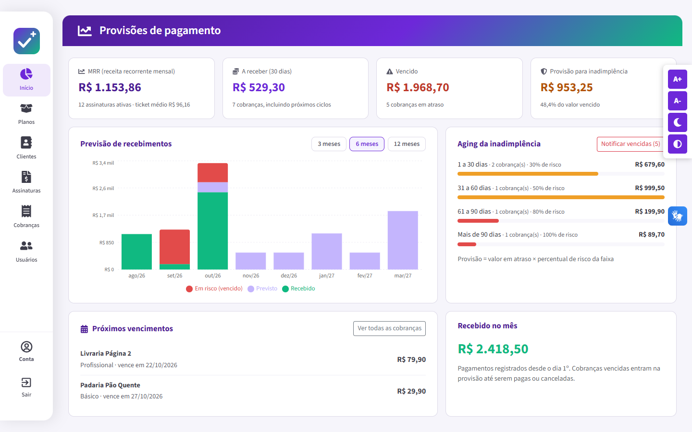
</p>

## Telas

| Login | Planos |
|---|---|
| 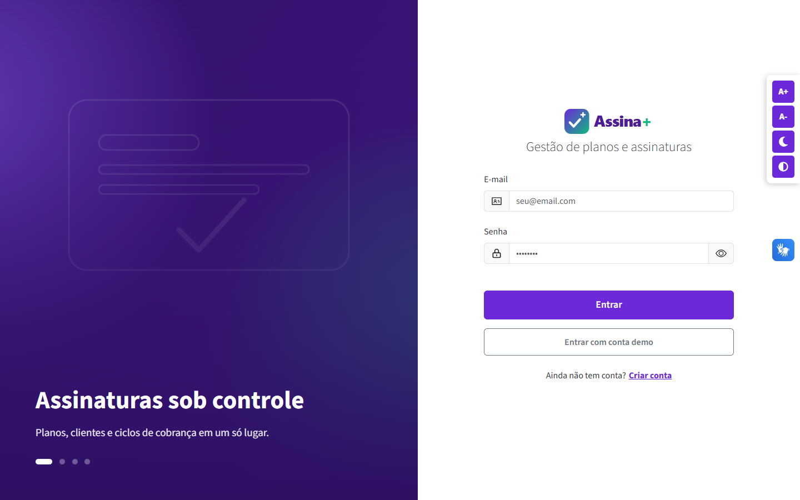 | 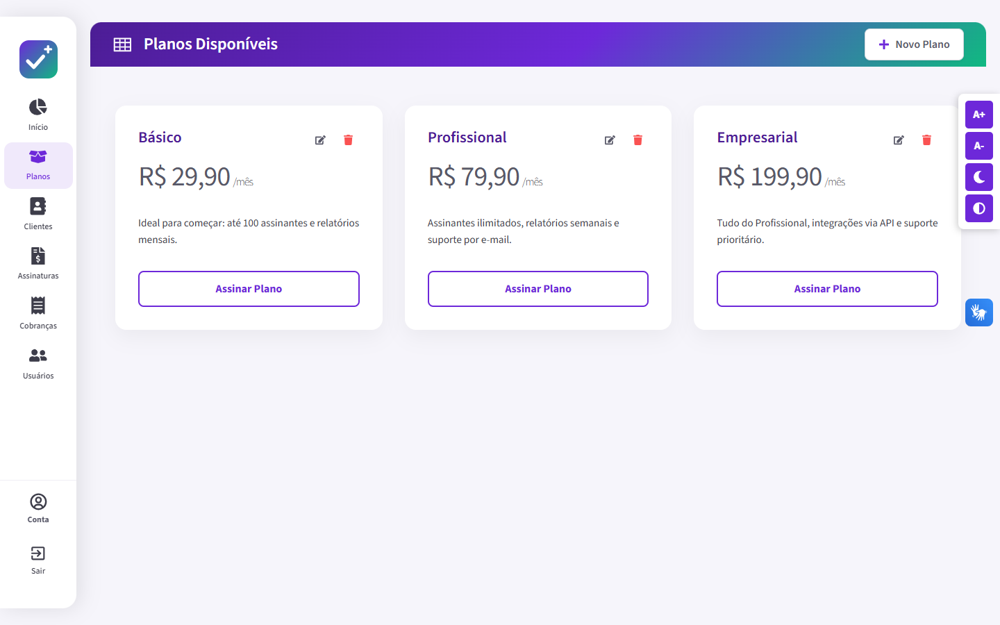 |
| **Clientes** | **Nova assinatura** |
| 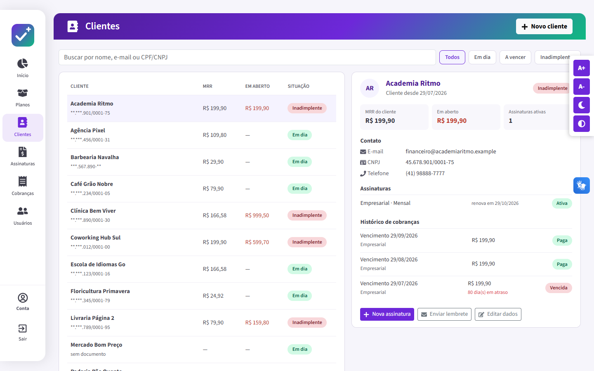 | 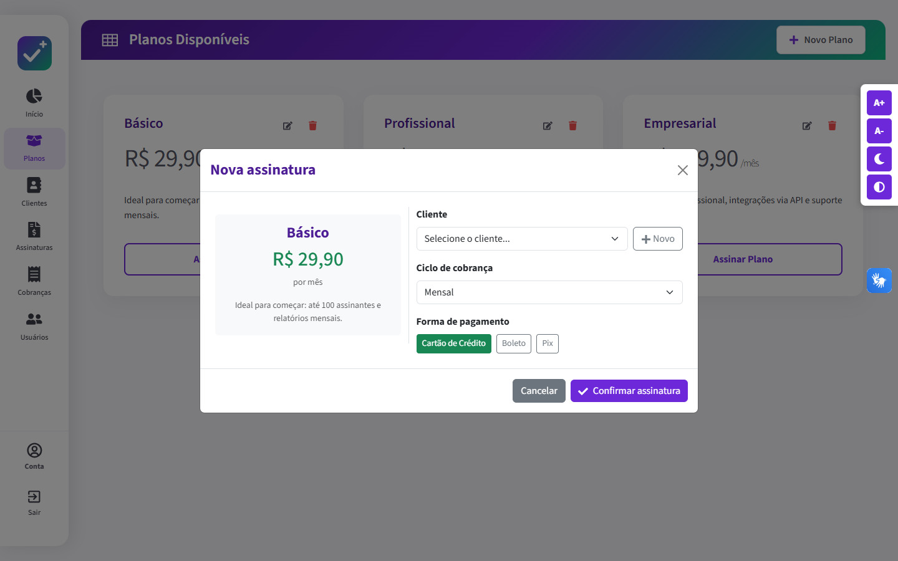 |
| **Assinaturas** | **Cobranças** |
| 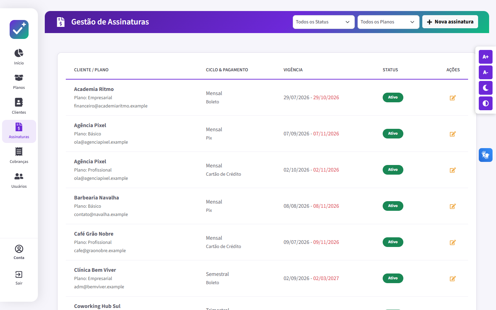 | 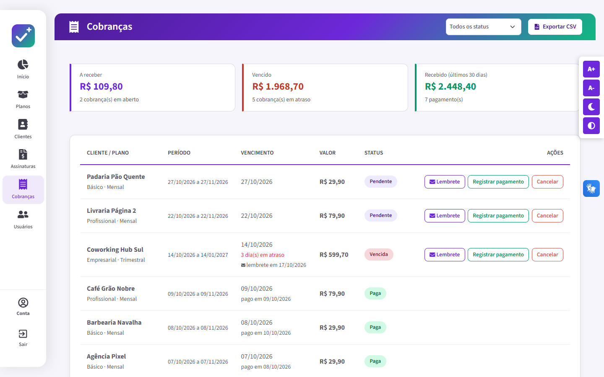 |
| **Usuários** | **Modo escuro** |
| 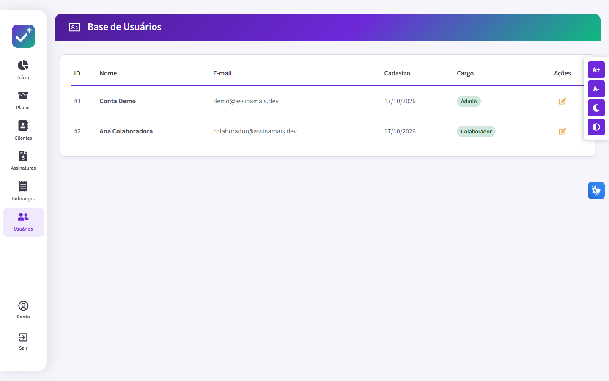 | 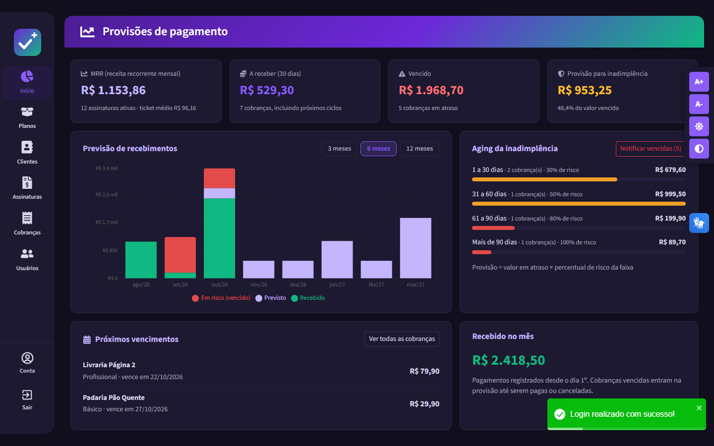 |
| **Alto contraste** | |
| 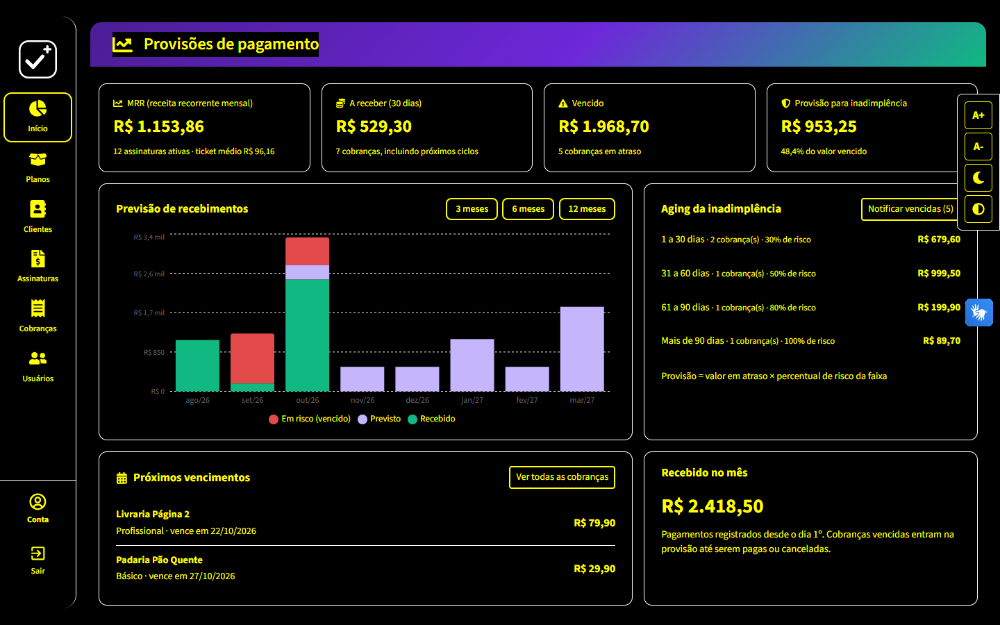 | |

<p align="center">
  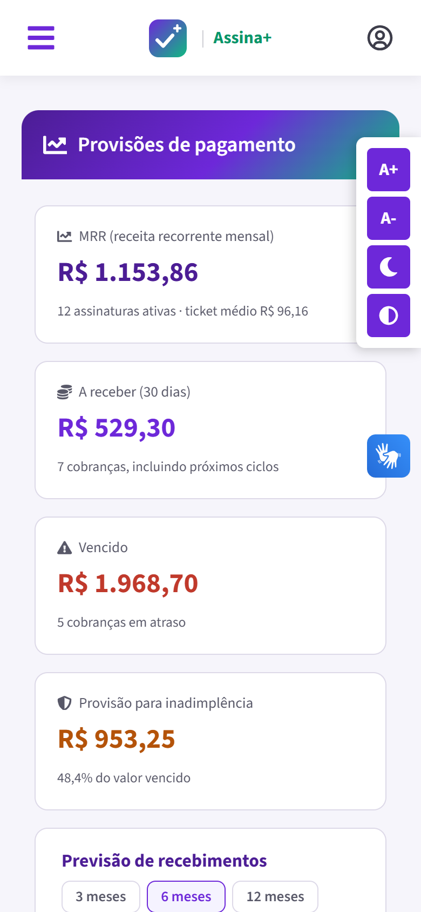
</p>

## Como testar

1. Suba a API seguindo o README do [backend](https://github.com/jessicaccl/gerenciamento-de-assinaturas-backend). Com Docker, é um comando só.
2. Rode o frontend:

```bash
npm install
npm run dev
```

3. Acesse http://localhost:5173 e clique em **Entrar com conta demo**.

| Perfil | E-mail | Senha |
|---|---|---|
| Admin | `demo@assinamais.dev` | `demo123` |
| Colaborador | `colaborador@assinamais.dev` | `demo123` |

A URL da API pode ser alterada copiando `.env.example` para `.env.local`. O padrão é `http://localhost:5029`.

## Funcionalidades

- **Login e cadastro** com JWT, botão de conta demo e sessão encerrada automaticamente quando o token expira
- **Painel de provisões** (tela inicial): MRR, valor a receber em 30 dias, valor vencido, provisão para inadimplência, gráfico de previsão de recebimentos (3, 6 ou 12 meses), aging do atraso e próximos vencimentos
- **Planos** em cards: criar, editar e excluir (somente Admin, com confirmação de senha) e assinar um plano para um cliente
- **Clientes**: lista com MRR, valor em aberto e situação (em dia, a vencer ou inadimplente), busca por nome, e-mail ou CPF/CNPJ e ficha com contato, assinaturas e histórico de cobranças
- **Nova assinatura** a partir do plano, do cliente ou da tela de assinaturas, com cadastro rápido de cliente sem sair do fluxo
- **Assinaturas**: listagem, edição de plano, ciclo e forma de pagamento, inativação e reativação
- **Cobranças**: totais a receber, vencido e recebido; registro de pagamento e cancelamento (Admin); dias em atraso; lembrete por e-mail; exportação em CSV
- **Notificar vencidas**: no painel, envia lembrete por e-mail para todos os clientes em atraso
- **Preço por ciclo**: ao assinar, mostra o valor do ciclo, o equivalente mensal e os meses grátis (semestral e anual)
- **Usuários**: listagem e edição de dados
- **Perfil** do usuário logado
- **Rotas protegidas**: páginas internas exigem login
- **Responsivo**: sidebar flutuante no desktop e menu lateral (offcanvas) no mobile

### Aparência e acessibilidade

- **Modo escuro** com a mesma identidade roxa e verde. Na primeira visita segue o tema do sistema operacional; depois, a escolha fica salva
- Ajuste de tamanho da fonte (A+ / A-)
- Modo de alto contraste, que preserva as cores das ilustrações
- Integração com o **VLibras** (tradução para Libras do Governo Federal)

## Stack

- **React 19 + TypeScript + Vite**
- **styled-components**, com estilos separados da lógica (`index.tsx` e `styles.ts` por página)
- **React Bootstrap** para modais, formulários e grid
- **Axios** com interceptors para injetar o token e tratar 401
- **React Router**, **React Toastify** e **Context API** (acessibilidade)
- **ESLint** e **GitHub Actions** (lint e build a cada push)

## Estrutura

```
src/
├── assets/images/     # Logo e ilustrações (SVG)
├── components/        # Sidebar, containers de página e barra de acessibilidade
├── css/               # Paleta de cores (tokens) e estilos globais
├── pages/             # Login, Dashboard, Planos, Assinaturas, Usuários e Perfil
├── routes/            # Rotas e proteção de rotas privadas
├── services/          # Camada de acesso à API (Axios)
└── types/             # Tipos compartilhados
```

## Decisões técnicas

- **Camada de serviços**: os componentes não chamam o Axios diretamente. Cada recurso tem o seu service (`PlanoService`, `AssinaturaService`...).
- **Mensagens de erro padronizadas**: `mensagemDeErro()` converte respostas da API (texto, validação ou ProblemDetails) em mensagens legíveis.
- **Interface por perfil**: ações administrativas só aparecem para Admin. Mesmo assim, quem bloqueia de fato é a API.
- **Tokens de design**: cores definidas como variáveis CSS (`--cor-primaria`, `--superficie-suave`, `--texto-perigo`...). O modo escuro só redefine esses tokens em `html[data-tema="escuro"]` e liga o tema escuro nativo do Bootstrap 5.3 (`data-bs-theme`), sem duplicar estilos de componente.

## Deploy (Vercel)

1. Na [Vercel](https://vercel.com), importe este repositório. O preset Vite é detectado automaticamente.
2. Em **Environment Variables**, defina `VITE_API_URL` com a URL da API publicada, por exemplo `https://assina-mais-api.onrender.com`.
3. Faça o deploy. O `vercel.json` já cuida das rotas da SPA.

## Scripts

| Comando | O que faz |
|---|---|
| `npm run dev` | Servidor de desenvolvimento |
| `npm run build` | Checagem de tipos e build de produção |
| `npm run lint` | ESLint |
| `npm run preview` | Serve o build localmente |

---

Desenvolvido por **Jessica Lima** · [GitHub](https://github.com/jessicaccl)
